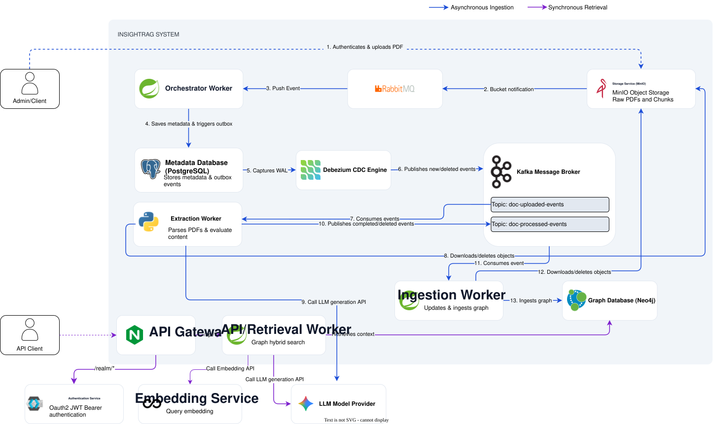

# InsightRAG

<div style="text-align: left;">


**Event-Driven GraphRAG Pipeline for Vietnamese Corporate Financial Analytics**

</div>

---

## Overview

**InsightRAG** is an enterprise-patterned data pipeline and GraphRAG system designed to structure and connect fragmented
financial disclosures. A universal bottleneck in financial analysis is that critical information remains trapped within
isolated, unstructured PDFs, making it nearly impossible to **programmatically query metrics or trace relationships**
across multiple reports. Standard vector-only RAG struggles to link these cross-page hierarchies or verify arithmetic
consistency.

To solve this, InsightRAG automates the ingestion of complex Vietnamese financial reports, including
dense multi-column tabular data, and transforms them into a **traversable knowledge graph**.
Engineered with a **decoupled, event-driven architecture**, the system bridges the gap between raw document storage and
**multi-hop LLM
reasoning**,
providing grounded answers with exact page-level citations.

---

## Architecture



## System Data Flow

### 1. Ingestion & Transactional Outbox (Steps 1-6)

* The client authenticates and uploads a raw corporate financial PDF to **MinIO**.
* MinIO emits an AMQP bucket notification to **RabbitMQ**, triggering the **Orchestrator Worker** (`insightrag-worker`).
* The Orchestrator computes an SHA-256 content hash for deduplication and persists both the document metadata and an
  outbox event into **PostgreSQL** within a single ACID transaction.
* **Debezium CDC** tails the PostgreSQL Write-Ahead Log (`wal-level=logical`) and publishes a guaranteed
  `doc-uploaded-events` message to **Apache Kafka**, decoupling the database from downstream extraction.

### 2. Asynchronous Graph Extraction (Steps 7-10)

* The **Python Extraction Worker** (`insightrag-extraction`) consumes the Kafka event, streams the raw PDF from MinIO,
  and runs layout parsing (**IBM Docling** + **LlamaIndex**) alongside LLM entity/relation extraction.
* Following the **Claim-Check Pattern**, the worker writes the extracted knowledge graph JSON back to MinIO preventing
  multi-megabyte payload from bloating Kafka broker and emits a lightweight `doc-processed-event` containing object
  reference.

### 3. Graph Synchronization (Steps 11-13)

* The **Ingestion Worker** (`insightrag-ingestion`) consumes the processed event, fetches the structured graph payload
  object from MinIO, and executes batched idempotent Cypher upsert into **Neo4j**.

### 4. Synchronous Retrieval & Chat

* An API Client submits a JWT-authenticated query via the **Nginx API Gateway** (`api-gateway`) to the **Retrieval
  Service** (`insightrag-retrieval`).
* The service generates dense Vietnamese query embeddings via [**Infinity**](https://github.com/michaelfeil/infinity) (
  `AITeamVN/Vietnamese_Embedding`), executes a hybrid vector + graph traversal search again **Neo4j**, and streams
  grounded answers with page citations back to the user.

---

## System Design & Trace-offs

### Event-Driven Reliability

* **Asynchronous Orchestration:** Utilizing MinIO bucket notifications and RabbitMQ queues decouple user uploads from
  heavy OCR and LLM graph extraction, preventing HTTP timeouts and absorbing traffic spikes.
* **Guaranteed Delivery (Transactional Outbox):** Capturing state change via PostgreSQL logical replication (Debezium
  CDC) eliminate dua-write race conditions between the relational metadata store and Kafka without polling overhead.
* **Claim-Check Payload management:** Passing MinIO object pointers over Kafka instead of raw PDF bytes or full
  Knowledge Graph JSON tree keeps Kafka message sizes under a few kilobytes.

### RAG & Data Engineering

* **Layout-Aware Table Parsing:** Integrates **Docling** with **LlamaIndex** to preserve complex Vietnamese accounting
  tables, financial codes, and parent-child row hierarchies across digital and scanned PDFs.
* **Hierarchical Chunking:** Documents are stored as a hierarchical tree structure to retain section semantics,
  linking high-level balance sheet line items directly to their corresponding explanatory footnote.
* **Hybrid Graph + Vector Retrieval:** Combines semantic vector similarity with multi-hop traversal to retrieve
  structurally connected financial nodes that lexical or vector search alone would miss.
* **Performance & Cost Control:** Enforces multi-layered caching (**Caffeine** in Java, **diskcache** in Python) and
  strict token budgets to minimize LLM latency and API spend.

### Architectural Trade-offs & Current Scope

* **Eventual Consistency vs. Write Throughput:** The ingestion pipeline priorities durability and non-blocking
  throughput over immediate read-after-write availability. Newly uploaded financial reports require asynchronous
  processing before appearing in Neo4j queries.

* **Single-Node Profile Segmentation:** The deployment blueprint is currently tuned for a single-node production host (
  or split-VM deployment via Docker Compose `--profile` segmentation) with strict `cgroups v2` resource limits.

---

## Supported Analytics & Evaluation Examples

Standard vector-only RAG pipelines frequently fail on corporate financial statements due to **cross-page table
fragmentation**, **ambiguous line-item names**, and **multi-column numeric drift**.

Below are real output generated by InsightRAG against Vietnamese corporate financial statements [(*Báo cáo tài chính Tập
đoàn Hòa Phát Quý
I/2026*)](https://file.hoaphat.com.vn/hoaphat-com-vn/2026/04/20260429-hpg-bctc-rieng-cong-ty-me-quy1-2026.pdf),
demonstrating cross-page footnote linking, entity traversal, ratio calculation, and accounting verification.

<details open>
<summary><b>Cross-Page Footnote Resolution & Disambiguation</b></summary>

> **Why this is hard:** The line item *"Phải thu khác" (Other Receivables)* appears twice on the Balance Sheet—under
> Current Assets (`Mã số 135`) and Non-Current Assets (`Mã số 215`). Naive vector search conflates the two sections.
> InsightRAG traverses the hierarchical graph from Page 3 to Footnote 3 on Page 15 to isolate the exact drivers for each
> timeframe.

**API Request (`POST /api/v1/chat`):**

```json
{
  "sessionId": "cross-page-session",
  "userQuery": "Khoản mục \"Phải thu khác\" xuất hiện ở cả phần tài sản ngắn hạn (Mã số 135) và tài sản dài hạn (Mã số 215). Hãy xác định các thành phần chi tiết nào trong thuyết minh dẫn đến sự biến động giá trị của cả hai khoản mục này tại thời điểm 31/03/2026 so với đầu năm"
}
```

**Grounded System Response (`sessionId: "cross-page-session"`):**
> Dựa trên thuyết minh báo cáo tài chính (Mục 3. Phải thu khác), sự biến động giá trị của hai khoản mục này tại ngày
> 31/03/2026 so với đầu năm (01/01/2026) được xác định bởi các thành phần chi tiết sau:
>
> **1. Phải thu ngắn hạn khác (Mã số 135)**
> Giá trị khoản mục này tăng từ **367.776.230.276 VND** lên **1.270.102.054.611 VND** `[Source: ocr_test.pdf, Page: 2]`.
> Các thành phần chi tiết gây ra sự biến động bao gồm:
> * **Phải thu từ hợp đồng BCC mà doanh nghiệp đồng kiểm soát:** Đây là yếu tố biến động lớn nhất, tăng từ **0 VND** lên
    **1.250.000.000.000 VND** `[Source: ocr_test.pdf, Page: 15]`.
> * **Phải thu về cổ tức:** Giảm từ **345.000.000.000 VND** về **0 VND** `[Source: ocr_test.pdf, Page: 15]`.
> * **Phải thu người lao động:** Tăng từ **628.704.227 VND** lên **743.108.475 VND** `[Source: ocr_test.pdf, Page: 15]`.
> * **Phải thu khác:** Giảm từ **22.129.240.717 VND** xuống còn **19.340.660.804 VND**
    `[Source: ocr_test.pdf, Page: 15]`.
> * **Ký cược, ký quỹ (ngắn hạn):** Không thay đổi, duy trì ở mức **18.285.332 VND** `[Source: ocr_test.pdf, Page: 15]`.
> * **Lãi phải thu:** Không phát sinh số dư tại cả hai thời điểm `[Source: ocr_test.pdf, Page: 15]`.
>
> **2. Phải thu dài hạn khác (Mã số 215)**
> Giá trị khoản mục này tăng từ **4.195.000.000 VND** lên **361.195.000.000 VND** `[Source: ocr_test.pdf, Page: 2]`. Sự
> biến động này được dẫn dắt bởi thành phần duy nhất trong thuyết minh:
> * **Đặt cọc, ký cược, ký quỹ (dài hạn):** Tăng từ **4.195.000.000 VND** lên **361.195.000.000 VND** (tương ứng mức
    tăng ròng là 357.000.000.000 VND) `[Source: ocr_test.pdf, Page: 15]`.

</details>

<details>
<summary><b>1-to-N Subsidiary Investment Graph Traversal</b></summary>

> **Why this is hard:** Requires linking the aggregate parent-company investment figure on Page 4 (
`97.005.138.052.366 VND`) with the detailed subsidiary breakdown table on Page 15 without losing rows or hallucinating
> entity names.

**API Request (`POST /api/v1/chat`):**

```json
{
  "sessionId": "1-to-n-session",
  "userQuery": "Dựa trên báo cáo tài chính của tập đoàn Hòa phát, tổng giá trị đầu tư vào công ty con tại ngày 31/03/2026 được phân bổ chi tiết cho những công ty nào và giá gốc đầu tư của từng công ty là bao nhiêu?"
}
```

**Grounded System Response (`sessionId: "1-to-n-session"`):**
> Dựa trên báo cáo tài chính của Công ty Cổ phần Tập đoàn Hòa Phát, tại ngày 31/03/2026, tổng giá trị đầu tư vào công ty
> con là **97.005.138.052.366 VND** `[Source: ocr_test.pdf, Page: 2, 14]`.
>
> Giá gốc đầu tư được phân bổ chi tiết cho các công ty con như sau:
> 1. **Công ty CP Gang thép Hòa Phát:** 73.999.220.000.000 VND `[Source: ocr_test.pdf, Page: 14]`.
> 2. **Công ty CP Phát triển Bất động sản Hòa Phát:** 10.598.000.000.000 VND `[Source: ocr_test.pdf, Page: 14]`.
> 3. **Công ty CP Sản phẩm Thép Hòa Phát:** 8.799.650.000.000 VND `[Source: ocr_test.pdf, Page: 14]`.
> 4. **Công ty CP Phát triển Nông nghiệp Hòa Phát:** 2.409.268.052.366 VND `[Source: ocr_test.pdf, Page: 14]`.
> 5. **Công ty CP Điện máy Gia dụng Hòa Phát:** 1.199.000.000.000 VND `[Source: ocr_test.pdf, Page: 14]`.

</details>

<details>
<summary><b>Multi-Period Variance & Proportional Liquidity Analysis</b></summary>

> **Why this is hard:** Answers why a line item's relative portfolio share *decreased* (`7,837%` $\rightarrow$ `6,470%`)
> even though its absolute value *more than doubled* (`+113%`), by automatically retrieving sibling node `Mã số 112` (
*Cash Equivalents*) to explain the denominator's expansion.

**API Request (`POST /api/v1/chat`):**

```json
{
  "sessionId": "multi-period-session",
  "userQuery": "Giá trị \"Tiền gửi ngân hàng không kỳ hạn\" có sự thay đổi như thế nào giữa ngày 01/01/2026 và ngày 31/03/2026, và tỷ trọng của khoản mục này trong tổng \"Tiền và các khoản tương đương tiền\" (Mã số 110) thay đổi ra sao?"
}
```

**Grounded System Response (`sessionId: "multi-period-session"`):**
> Dựa trên các dữ liệu từ tài liệu được cung cấp, sự thay đổi của khoản mục "Tiền gửi ngân hàng không kỳ hạn" và tỷ
> trọng của nó trong "Tiền và các khoản tương đương tiền" (Mã số 110) được xác định như sau:
>
> **1. Thay đổi về giá trị tuyệt đối:**
> * Tại ngày 01/01/2026: **37.944.020.522 VND** `[Source: ocr_test.pdf, Page: 13]`.
> * Tại ngày 31/03/2026: **80.837.705.644 VND** `[Source: ocr_test.pdf, Page: 13]`.
> * **Biến động:** Giá trị "Tiền gửi ngân hàng không kỳ hạn" đã tăng thêm **42.893.685.122 VND** (tương đương mức tăng
    khoảng 113%) trong quý 1 năm 2026.
>
> **2. Thay đổi về tỷ trọng trong "Tiền và các khoản tương đương tiền" (Mã số 110):**
> * **Tại ngày 01/01/2026:**
>* Giá trị Mã số 110: **484.137.929.006 VND** `[Source: ocr_test.pdf, Page: 2]`.
>
>* Tỷ trọng: $37.944.020.522 / 484.137.929.006 \approx 7,8374401\%$.
> * **Tại ngày 31/03/2026:**
>* Giá trị Mã số 110: **1.249.475.911.267 VND** `[Source: ocr_test.pdf, Page: 2]`.
>
>* Tỷ trọng: $80.837.705.644 / 1.249.475.911.267 \approx 6,469729\%$.
>
> **Kết luận:**
> Mặc dù giá trị tuyệt đối của "Tiền gửi ngân hàng không kỳ hạn" tăng hơn gấp đôi, nhưng tỷ trọng của khoản mục này
> trong tổng "Tiền và các khoản tương đương tiền" lại **giảm từ khoảng 7,837% xuống còn khoảng 6,470%**. Nguyên nhân là
> do tổng quy mô của Mã số 110 tăng trưởng mạnh hơn (tăng từ 484.137.929.006 VND lên 1.249.475.911.267 VND), chủ yếu
> được thúc đẩy bởi sự gia tăng của "Các khoản tương đương tiền" (Mã số 112) từ 445.373.071.918 VND lên
> 1.167.743.613.917
> VND `[Source: ocr_test.pdf, Page: 2]`.

</details>

<details>
<summary><b>Accounting Identity & Depreciation Audit</b></summary>

> **Why this is hard:** Validates that the OCR and table parser preserved parenthetical negative accounting notation
`(159.399.347.537)` for accumulated depreciation and reconciles the net book value identity cleanly.

**API Request (`POST /api/v1/chat`):**

```json
{
  "sessionId": "accounting-identity-session",
  "userQuery": "Hãy xác minh tính hợp lệ của giá trị \"Tài sản cố định hữu hình\" (Mã số 221) tại ngày 31/03/2026 bằng cách sử dụng các dữ liệu về nguyên giá (Mã số 222) và giá trị hao mòn lũy kế (Mã số 223) tương ứng"
}
```

**Grounded System Response (`sessionId: "accounting-identity-session"`):**
> Dựa trên dữ liệu tại báo cáo tình hình tài chính công ty mẹ tại ngày 31/03/2026, tính hợp lệ của giá trị "Tài sản cố
> định hữu hình" (Mã số 221) được xác minh như sau:
>
> * **Nguyên giá (Mã số 222):** 187.686.445.431 VND `[Source: ocr_test.pdf, Page: 3]`.
> * **Giá trị hao mòn lũy kế (Mã số 223):** (159.399.347.537) VND `[Source: ocr_test.pdf, Page: 3]`.
>
> **Phép tính xác minh:**
> Giá trị còn lại (Mã số 221) = Nguyên giá (Mã số 222) + Giá trị hao mòn lũy kế (Mã số 223)
> $= 187.686.445.431 + (-159.399.347.537) = \mathbf{28.287.097.894\text{ VND}}$
>
> **Kết luận:**
> Kết quả tính toán khớp hoàn toàn với giá trị ghi nhận tại khoản mục **Tài sản cố định hữu hình (Mã số 221)** là *
*28.287.097.894 VND** tại ngày 31/03/2026 `[Source: ocr_test.pdf, Page: 3]`. Do đó, giá trị này là chính xác và hợp lệ
> theo dữ liệu báo cáo.

</details>

---

## Quick Start

The entire infrastructure is containerized using multi-profile Docker Compose overlays (`dev` and `prod`) managed via
`docker/manage.sh`.

### Prerequisites

- **Docker Engine `v25.0.3+`** & **Docker Compose `v24.4.4+`**
- Configure environment variables by copying `.env.example` to `.env` in `docker/`, `insightrag-core/`, and
  `insightrag-extractor/`.

### Launch the Stack

```bash
cd docker
chmod +x manage.sh scripts/*.sh

# Start all pipeline & retrieval services in development mode
./manage.sh all up -d

# Or start only the Retrieval API and its required dependencies
./manage.sh dev retrieval up -d

# Verify container health status
./manage.sh dev all ps

```

For production deployment with `cgroups` resource limits, Nginx reverse proxy routing, and locked-down internal ports,
see the [Docker Infrastructure & Deployment](docker/README.md)

---

## Documentation Index

- [Docker Infrastructure & Deployment](docker/README.md)
- [System Architecture Diagram](docs/assets/architecture.svg)
- [Architecture Decision Records (ADRs)](docs/architecture/ADRs)
- [REST & SSE API Reference](docs/api/README.md)
- [Day-2 Operations Guide](docs/operations)
