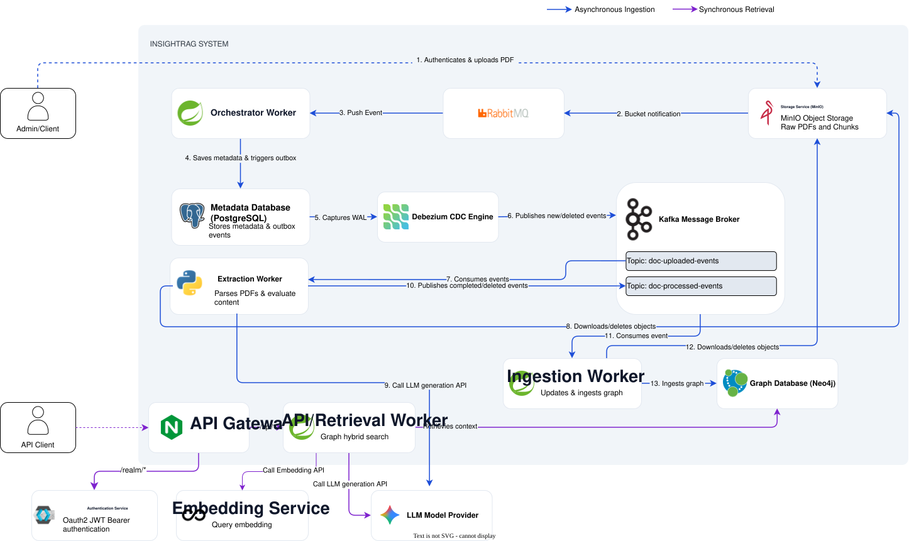

# InsightRAG Engineering Documentation

This directory contains the foundational documentation for the InsightRAG system.

## Directory Overview

* **/architecture/ADRs**: Historical logs of significant architectural decisions and engineering trade-offs.
* **/api**: API contracts, integration guidelines, and Swagger/OpenAPI details.
* **/operations:** Runbooks for local deployment, testing, and data management.
* **/assets**: Static assets, including system architecture diagrams.

---

## Architecture Decision Records (ADRs)

We use Architecture Decision Records to document the "why" behind the system's design. Each record captures the context,
the decision made, the resulting consequences.

| ADR                                                                  | Title                                                  | Domain                 | Status   |
|----------------------------------------------------------------------|--------------------------------------------------------|------------------------|----------|
| [ADR-0001](architecture/ADRs/0001-idempotent-document-upserts.md)    | Idempotent Document Upserts via Sequencer Checking     | Database / Concurrency | Accepted |
| [ADR-0002](architecture/ADRs/0002-embed-debezium-engine-for-cdc.md)  | Embedded Debezium Engine for Change Data Capture       | Messaging / Infra      | Accepted |
| [ADR-0003](architecture/ADRs/0003-adopt-graphrag-over-vector-rag.md) | GraphRAG Architecture for Financial Document Reasoning | AI / Search            | Accepted |

---

## API Documentation

The retrieval endpoints are fully documented using OpenAPI 3.1.

Review the [API Integration & Contracts](api/README.md) guide for Keycloak authentication flows, Swagger UI access, and
sample GraphRAG streaming queries.

---

## Operations & Runbooks

Operational guides for managing the local development environment and data infrastructure.

* [Local Development & Data Resets](operations/local-development-data-resets.md) - Instructions for safely wiping the
  Neo4j graph, purging MinIO storage during manual testing.

---

## System Architecture

The high-level macro architecture separating the asynchronous ingestion pipeline from the synchronous retrieval API.

